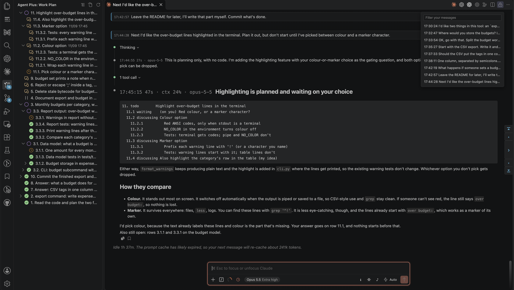

# Claude Code Plus

Claude Code Plus gives Claude a work plan, so that Claude does not lose track of unfinished work when you switch topics before the work is done, or when compaction summarizes older turns. Claude starts a plan when there is work to track and updates it as you talk. Each piece of work is a numbered row in the plan.

The plan is stored in a file outside the conversation, and Claude gets its open rows every turn. Agent Plus, a separate extension installed along with this one, shows the plan in a view beside the Claude Code panel.

Agent Plus's Conversations tab in the VS Code panel lists running Claude Code conversations in this window's workspace folders. Stopped conversations also appear if their plan still has open rows and was written in the last 7 days. A row that waits for your answer carries a question; the question appears under its conversation, and an answer entered in the Answer view next to the Conversations tab goes into that conversation's message input.

Requires Anthropic's Claude Code extension, Agent Plus and VS Code 1.96 or later. The work plan also needs Python 3.7 or later. On Windows without Python, the extension offers to download it from python.org (11 MB).

## What it looks like

The work plan on the left of the Claude Code panel:



## Work plan

Claude starts a plan when you bring up work it should track, or when you ask for one.

If a conversation runs long without a plan, Claude gets a one-time suggestion to start one (see [Settings](#settings) for what counts as long).

### Row numbers

Rows have numbers such as 1, 2 and 2.1. You can answer several rows in one message, in any order:

```text
2.1: not now
3: go ahead
```

A row's number is its position in the plan file, so it does not change: finishing row 2 leaves a gap instead of renumbering the rows after it. A child row such as 2.1 is work that has to be done before its parent can be finished.

### States

| State | Meaning |
| --- | --- |
| `discussing` | Raised, not agreed yet. |
| `todo` | Agreed, not started. |
| `doing` | Being worked on now. |
| `waiting` | Started, but held up by something outside the conversation, such as you, a build or CI run, a reviewer or another conversation. |
| `parked` | Left for later, with the reason; still open. |
| `done` | Finished. |
| `dropped` | Decided against, with the reason. |

Work you ask Claude to do now goes straight to `doing`. Work Claude suggests on its own starts as `discussing` and becomes `todo` only when you agree.

### How Claude gets the plan

The extension registers a Claude Code plugin whose hooks hand the plan to Claude on each turn and around compactions. Its skill holds the rules Claude follows to keep the plan up to date.

- The plugin's skill description loads in every session at about 110 tokens.
- With a plan, every turn carries its open rows: the whole block, with the instructions, on the first turn and the first after each compaction; a short head when a row has changed; one line when none has. Rows that are `doing` and questions to you carry their notes; other rows show their title only. A finished row can be included when a row under it is still open. The block is cut to fit 6,000 characters, and a last line says how many open rows were left out. See [What it costs in tokens](#what-it-costs-in-tokens).
- Before an automatic compaction, Claude is asked to bring the rows it is working on up to date. After compaction, it is asked to read the plan file before anything else.

### Where the plan lives

Each conversation has one file, named by session ID, under `~/.claude/plugins/data/agent-work-plan-claude-code-extras/`.

Claude writes the file through a small command shipped with the plugin. To correct a plan by hand, open its file from the view's title-bar button or a row's context menu.

See [How the work plan works](docs/how-the-work-plan-works.md) for the hooks, thresholds and measurements.

## Install

Search for **Claude Code Plus** in the Extensions view, or run
`code --install-extension xnervwang.claude-code-plus`. Anthropic's Claude Code extension and
Agent Plus install as dependencies.

If you have Work Plan for Claude Code (`xnervwang.claude-code-extras`), update it to its last version, which installs Claude Code Plus (`xnervwang.claude-code-plus`); you can then uninstall the old extension. While an earlier version of the old extension is installed, Claude Code Plus does nothing except show a warning when you run a command, because both extensions would patch the same Claude Code files. If you uninstall an earlier version of the old extension, VS Code runs its uninstall step on the next start: it copies plans to `~/.claude/agent-work-plan-plans-<time>/`, then unregisters the plugin. Within half a minute, Claude Code Plus registers the plugin again and copies the plans back. On its first start, Claude Code Plus copies `claudeCodeWorkPlan.*` and `claudeCodeExtras.*` settings to `claudeCodePlus.*`, except those kept in a remote machine's own settings file, which you rename by hand. On each start, Claude Code Plus copies pins and session colors from the old extension's storage unless it already has its own. Install Claude Code Plus before uninstalling the old extension, since VS Code deletes that storage when it finishes removing the old extension at its next start.

The extension works by editing files inside the installed Claude Code extension. Reload the
VS Code window twice after installing. Run `Claude Code Plus: Show Status` for the patch
status. In a Remote SSH window, install on the remote.

Verified against Claude Code 2.1.322.

## Other features

| Feature | What it shows | Where it appears |
| --- | --- | --- |
| Timestamps | Times from the transcript on every message and reply block, with `start→result` on tool calls; Claude Code's own message times are hidden while these are on. | Messages, reply blocks, tool calls |
| Your time zone for Claude | When Claude runs on a machine in another time zone, as with Remote SSH, it is told yours, so it gives you times in your zone. | Claude's context |
| Reply figures | `2m10s · ctx 33% · cost $0.42 · opus-5 high` shows turn duration, context-window use, running spend, model and effort. | Each reply |
| Sub-agent tags and filters | Tag each sub-agent's messages with its task, such as `#look up tomorrow's weather`, and filter to the main thread or one sub-agent. | Tags on messages; filter in the footer |
| Conversation navigation | Find your messages by time and first words or find compaction points; filter, click to scroll, step with arrows or `,` and `.`, or jump to the top or bottom. | Right edge of the panel |
| Focus view button | Toggle Claude Code's own Focus view; while it is on and Claude works, the working line shows the latest tool call and elapsed time, such as `Bash running for 2m55s (since 11:11:18)`. | Footer button; working line |
| Context meter | Keep the meter visible, outline it when 15% of the window remains, and hover for a breakdown by category, memory files and custom agents. | Panel's context meter |
| Open sessions | The conversations open in this window, in an editor tab or in the sidebar while it is shown, most recently active first, each with the status dot the session list gives it; click one to switch to it. | Top of the session list |
| Open in a tab or the sidebar | **New in tab** and **New in sidebar** replace the New session button. A closed conversation's right-click menu offers **Resume in tab** and **Resume in sidebar** instead of Resume session; an open one keeps Switch to session. These do not change `claudeCode.preferredLocation`; the Claude button at the right of the editor tabs still opens where that setting says. | Session list |
| Delete archived conversations | **Delete session…** in an archived conversation's right-click menu permanently deletes it from disk once you confirm: its transcripts, sub-agent conversations, saved tool outputs, file checkpoints (Claude Code's copies, not your files), debug log and work plan. A conversation open in a tab or the sidebar, or still running, is left alone. | Archived sessions in the session list |
| Section and session ID on hover | Hovering over a conversation shows its session ID and where it sits in the list below Open sessions: its group, Ungrouped or Archived sessions. Rows in Open sessions show the same. | Session list |
| Search by session ID | The search box also finds a conversation by part of its session ID, such as `69f9`: four or more characters, using only 0-9, a-f and hyphens. Shorter searches, and ones with other characters, match titles and branches only. | Session list |
| RECENTLY CLOSED | The conversations whose Claude Code editor tabs you closed in this workspace, most recently closed first; the list is kept across reloads. Click one to open it again. The section starts collapsed. Open conversations are not listed, and up to `claudeCodePlus.recentClosedSessions` are shown (10 by default). | Session list, directly above Open sessions |
| Session dates | Adds the dates of the first and last messages after Claude Code's last-active time: `11d` becomes `11d · 09/05→09/16`. | Session list |
| Pinned conversations | Click the pin at the start of a session-list row to keep that conversation from Claude Code's transcript cleanup (`cleanupPeriodDays`) and out of Archived sessions, as long as a window keeps connecting to its machine (see Known limits). | Session list |
| Text colors | Right-click a conversation and choose **Text color** to give its title one of the colors of Claude Code's `/color`. The color shows wherever the conversation is listed. | Session list |
| Background sessions left out | The list skips sessions started with `claude --bg` or `claude -p`, and empty transcripts. Turn off `claudeCodePlus.hideBackgroundSessions` to see them. | Session list |
| Chimes | A short sound when a turn finishes, permission is requested or Claude asks a question, played on the machine showing the panel; mute it in the footer. | Footer; machine showing the panel |
| Background sessions | This conversation's `claude --bg` sessions, each state in its own colour and counted at the top, with what each waits for, its result, and the attach and logs commands. | Agents button in the footer and the agent map it opens |
| Scheduled prompts | See timers this conversation set through Claude Code's scheduled tasks, with each schedule, last-fired time and prompt. | Agents button in the footer and the agent map it opens |
| Background commands | See a count such as `1 task` while a background build, test run or `sleep` timer runs, with the list one click away. | Footer |
| Tabs back after a restart | Claude Code tabs that were open when the window closed but that VS Code did not restore, as can happen after the window lost its remote connection, are opened again when it starts. Tabs you closed while connected stay closed. | Editor tabs |
| Status dots | A Claude Code tab's logo shows a green dot while Claude works, where Claude Code shows none, and a red one instead of Claude Code's orange when it finished while you were away. The session list uses the same green and red. | Editor tabs, session list |
| Session information | See the session ID, Claude's process ID, starting directory, transcript location and size, and how much the work plan has added since the last compaction; click a value to copy it. | Footer button |

## What it costs in tokens

The tables show the text Claude Code Plus adds to what Claude Code sends the model. All of it comes from the work plan plugin Claude Code Plus registers with Claude Code; what Claude Code Plus draws in VS Code sends nothing to the model. Text added to a conversation stays in context and goes with every later model call until compaction replaces the conversation with a summary. A token is about four characters of English.

### Added to every message

| What | When | At most | Turned off by |
| --- | --- | --- | --- |
| The work plan | Each message, while the conversation's plan has a row that is not `done` or `dropped`. The whole block, with what the states mean and how to change a row, on the conversation's first message and the first after each compaction; a short head in its place otherwise; one line when no row has changed since the message before | 6,000 characters, the brief included; the one line is about 160 characters and the plan's path | `claudeCodePlus.workPlan` |

### Added now and then

| What | When | At most | Turned off by |
| --- | --- | --- | --- |
| End-of-turn reminders | At the end of a turn that left rows `doing`, asked you something without putting the question on a row, or changed things without reading or updating the plan | About 2,400 characters and the paths of the plan and of the row command, when every reminder and both of the brief's requests come at once | `claudeCodePlus.workPlan` |
| The brief's requests | At the end of a turn: the status once per turn, after a turn that did work; the summary when there is none, after a top-level row was added, removed or closed, and after a compaction | Included in the end-of-turn reminders | `claudeCodePlus.conversationBrief` |
| No row `doing` | At most once per turn, when the main thread has made three tool calls or changed two things besides the plan and no row is `doing` | About 430 characters, and the plan's path and the row command's path twice each | `claudeCodePlus.workPlan` |
| Before a compaction | At 170k, 180k and 195k tokens of a 200K window, or 960k, 970k and 995k of a 1M window, once each between compactions, while a row is `doing`; said once more at the end of the turn if the plan was not written | About 540 characters, and the plan's path and the row command's path once each | `claudeCodePlus.workPlan`; `claudeCodePlus.workPlanQuietWhenReplyMatches` |
| After a compaction | Once per compaction | About 950 characters, the plan's path, and the path of its closed rows when it has any | `claudeCodePlus.workPlan`; `claudeCodePlus.workPlanQuietWhenReplyMatches` |
| The offer of a plan | Once, in a conversation with no plan, after your third message and a turn of 25 tool calls | About 390 characters and the plan's path | `claudeCodePlus.workPlan`; `claudeCodePlus.workPlanOfferMinTurns`, `claudeCodePlus.workPlanOfferMinToolCalls` |
| A write to the plan, refused | When Claude writes or edits the plan file with a row description longer than the view shows, or a question that asks more than one thing | About 450 characters | `claudeCodePlus.workPlan` |
| Your time zone | When the panel reads in another time zone than this machine's: on the conversation's first message and after each compaction, then when either side's date turns over, the offset changes, or the context has grown by 100k tokens | About 300 characters | `claudeCodePlus.tellClaudeYourTimeZone` |

- The work plan is cut at 6,000 characters by the plugin. The reminders have no cut: each is fixed text with at most six row titles of 60 characters.
- Rows closed more than a day ago are moved out of the plan file to `closed/<session ID>.json` beside it, so reading the plan after a compaction costs less too; Agent Plus's views read both files.

### Sent with every call

| What | When | At most | Turned off by |
| --- | --- | --- | --- |
| The work plan skill in Claude Code's list of skills | Every call | Its name and a 573-character description, about 110 tokens | `Claude Code Plus: Stop Loading the Work Plan Plugin` |

### Costing nothing

- Everything Claude Code Plus and Agent Plus draw in VS Code.
- An answer you give in Agent Plus's Answer view is typed into the conversation and sent as your message, as if you had typed it there.
- The information button shows, for the conversation in front, how many times the work plan was added since the last compaction, how many characters that came to, and about what share of the context in use.

### Typical values

Measured on 2026-11-11 on one machine.

| What | Typical | How it was measured |
| --- | --- | --- |
| The work plan, whole block | Median 2,246 characters, 90th percentile 4,720 | The 41 Claude Code plans written on that machine in the 14 days before; each was copied and put through the work plan plugin's hook that adds the plan to a message, once |
| The work plan, short head | Median 1,102 characters, 90th percentile 3,576 | The same plans |
| The work plan, one line | 220 characters with a 60-character path | The same plans |
| Messages whose plan is unchanged since the message before | 48% | 8,587 messages with the plan in 63 Claude Code conversations over the same 14 days, counted as unchanged when only how long a row had been in its state differed; counted by `build/plan-injection-stats.js` in Agent Plus's repository |

## Settings

Open `Claude Code Plus: Settings` for all 37 settings. Most take effect without a reload. Installing or upgrading the patch needs one.

**Work plan settings**

| Setting | Default | What it does |
| --- | --- | --- |
| `claudeCodePlus.workPlan` | on | Turns the work plan on or off. When off, Claude is told nothing about plans and cannot write one. |
| `claudeCodePlus.workPlanOfferMinTurns` | 3 | Messages you must have sent before a conversation without a plan is offered one. |
| `claudeCodePlus.workPlanOfferMinToolCalls` | 25 | Tool calls one turn must make before that offer. |
| `claudeCodePlus.workPlanQuietWhenReplyMatches` | empty | A regular expression tested on the latest reply. If it matches, the prompts before and after compaction are not sent. Use it for conversations that relay another model's replies word for word. When empty, it never matches. |
| `claudeCodePlus.conversationBrief` | on | Each conversation is asked to keep a brief: a summary, and where it stands now. Clicking the conversation in Agent Plus's Conversations panel then shows the brief instead of going to the conversation. |

**To turn off**

| What | How |
| --- | --- |
| Timestamps, reply figures and sub-agent tags | Set `claudeCodePlus.enabled` to off. Every other addition has its own `claudeCodePlus.show.*` setting. The patch stays and its scripts keep running. |
| Your time zone in Claude's context | Set `claudeCodePlus.tellClaudeYourTimeZone` to off. |
| Work plan plugin, skill description included | Run `Claude Code Plus: Stop Loading the Work Plan Plugin`. |
| Reopening Claude Code tabs VS Code did not restore | Set `claudeCodePlus.reopenDroppedTabs` to off. |
| Pins on the session list | Set `claudeCodePlus.sessionPins` to off. Pinned conversations are then cleaned up and archived as usual. |
| Patch and restore Claude Code's files | Run `Claude Code Plus: Remove from Claude Code (restore original files)`, or uninstall. |

Message appearance: `claudeCodePlus.userMessageColor` and `claudeCodePlus.userMessageEdge`.

## Commands

| Command | What it does |
| --- | --- |
| `Claude Code Plus: Install the Work Plan Plugin for Claude Code` | Register the plugin again. |
| `Claude Code Plus: Stop Loading the Work Plan Plugin` | Remove the plugin from Claude Code's settings. |
| `Claude Code Plus: Settings` | Open this extension's settings. |
| `Claude Code Plus: Toggle On/Off` | Toggle the timestamps, reply figures and sub-agent tags. |
| `Claude Code Plus: Turn On` | Show them. |
| `Claude Code Plus: Turn Off` | Hide them. |
| `Claude Code Plus: Remove from Claude Code (restore original files)` | Restore Claude Code's files. |
| `Claude Code Plus: Show Status` | Show patch status and what was patched. |
| `Claude Code Plus: Show How Long Opening a Panel Took` | Show recorded panel-opening times. |

## Known limits

- A plan file is deleted once its conversation's transcript is gone and the file has not been written for a week. Claude Code removes old transcripts, apart from those of conversations pinned on the session list.
- Uninstalling tries to copy plans to `~/.claude/agent-work-plan-plans-<timestamp>/` before unregistering the plugin, which deletes its data directory. Uninstalling continues if the copy fails, so keep your own copy of a plan that matters.
- Disabling the extension leaves the patch in place. Run `Claude Code Plus: Remove from Claude Code (restore original files)` first.
- After you reload a window that lost its remote connection, the remote machine keeps the Claude Code processes from before the reload running for five minutes, then stops them. A Claude Code tab that VS Code did not restore, and whose conversation is still running there, opens only then, about five minutes after the reload. If Claude was writing a reply in it, the reply stops at that point; what it had written so far stays in the conversation.
- If you close a Claude Code tab while the window cannot reach its remote machine, the tab opens again the next time the window starts, because the close could not be recorded. Close it again once connected.
- A yellow circle with an exclamation mark at the panel's top right means a Claude Code build changed something the patch relies on, and some panel features are not working.
- To protect a pinned conversation, the extension moves its files' modification time forward once they are old enough for the cleanup. The row still shows when the conversation was last active, but the list sorts it by the moved time. Uninstalling the extension removes the pins; the conversations stay, and the cleanup treats them as usual again.
- A pin protects a conversation only while some VS Code window with this extension connects to the machine that holds its transcript, and stays open for at least a minute, at least once every `claudeCodePlus.sessionPinsMarginDays` days (14 by default, and never more than half of `cleanupPeriodDays`). The folder the window has open does not matter: each window refreshes every pinned conversation on that machine a minute after it starts and every 30 minutes while it stays open. After a longer gap, Claude Code's cleanup can delete pinned conversations the next time Claude Code runs on that machine, in a terminal or as a background session.
- Pins are kept on the machine that holds the transcripts. Pins on your computer do not protect a remote machine's conversations, or the other way round; a remote machine's pins are refreshed only by windows connected to it.
- Editor-tab panels that stay blank in every window after running version 1.0.8 or earlier of the old extension: quit VS Code and delete the `CacheStorage` folders under `WebStorage` in VS Code's data folder (`~/Library/Application Support/Code` on macOS, `%APPDATA%\Code` on Windows, `~/.config/Code` on Linux).

## Contributing

See [CONTRIBUTING.md](CONTRIBUTING.md) for the layout, checks, and verified-build records.

## License

BSD 3-Clause.
